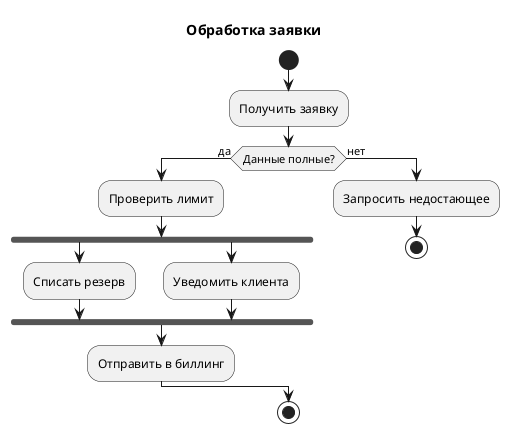
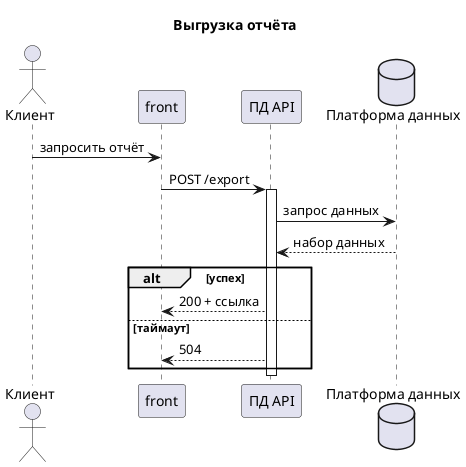
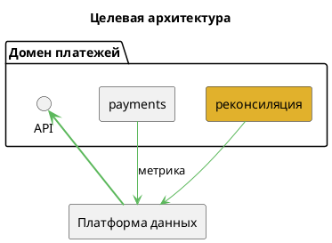
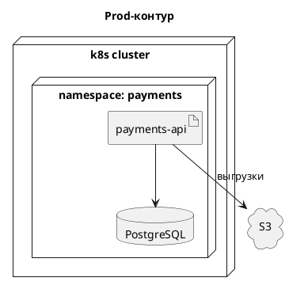
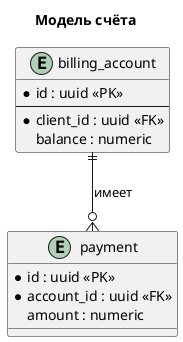
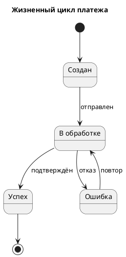
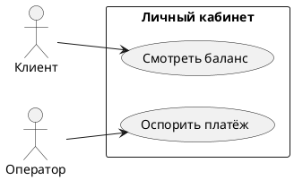
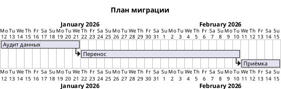
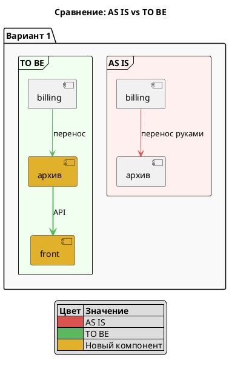

# Варианты PlantUML — выбор и скелеты

Читать при непонятном вопросе запроса. Один основной вариант; метки на языке пользователя.

## Порядок выбора

1. Что меняется во времени? → Activity, Sequence, State, Timing.
2. Что существует в покое? → Component, Deployment, Class/ER, Use case.
3. Ни то ни другое (план, декомпозиция, сравнение)? → Gantt/WBS, Mindmap, двухстороннее сравнение.
4. Неясно? Самый дешёвый вариант + альтернатива одной строкой.

«Что читатель сделает с картинкой?» — отладка → sequence, ревью дизайна → component, управление → activity/сравнение.

## Activity (новый синтаксис) — процесс, шаги

Сигналы: процесс, алгоритм, шаги, сценарий, workflow, BPMN, ветвления.

Полезное: `|Отдел|` — дорожки; `partition "Этап" { ... }`; `detach` — терминал без заливки.

## Sequence — взаимодействие, порядок вызовов

Сигналы: обмен, API, запросы, интеграция, вызовы, handshake, retries, timeouts.

Полезное: `++`/`--` вместо activate/deactivate; `alt/opt/loop/par`; `autonumber`; `== Этап ==`.

## Component — архитектура, сервисы

Сигналы: архитектура, из чего состоит, сервисы, модули, интеграции, зависимости.

Полезное: `package`/`frame`/`rectangle` — границы; `#E1B12C` — новое в целевом состоянии; стрелки — сообщение, коробки — существительные.

## Deployment — окружения, ноды

Сигналы: окружения, ноды, кластеры, развёртывание, инфраструктура, prod/dev, Kubernetes.

Полезное: `node`, `cloud`, `database`, `artifact`, `storage`; вкладывание нод — реальное содержание; протоколы и порты на стрелках.

## Class / ER — модель данных, схема БД

Сигналы: модель данных, сущности, таблицы, поля, связи, БД, домен, cardinality.

Полезное: `entity` — ER (crow's-foot), `class` — UML-классы; `*` — обязательно, `--` — разделитель, `<<PK>>`; только нужные атрибуты.

## State — жизненный цикл, статусы

Сигналы: статус, состояния, жизненный цикл, переходы, state machine, retry.

Полезное: `state "имя" as alias { ... }` — составные; `[*]` — начальное/конечное; переходы подписаны событиями. Имена состояний с пробелами/не-ASCII — только через `as`, иначе сервер откажет.

## Use case — роли и возможности

Сигналы: роли, акторы, кто что может, возможности, требования.

## Gantt / WBS — планы и декомпозиция

Сигналы: сроки, этапы, план, дорожная карта, декомпозиция, work breakdown.

Полезное: `@startwbs` с `*` — дерево; `@startmindmap` — брейншторм; только когда время/иерархия и есть ответ.

## AS IS / TO BE — сравнение

Сигналы: AS IS / TO BE, было / стало, сравнить, до и после.

Полезное: обе стороны — один вариант и одни имена; >2 вариантов или >15 элементов на сторону — отдельная диаграмма на вариант.

## Прочие

`timing` — сигналы во времени, `object` — снимок экземпляра, `json`/`yaml` — структура payload, `salt` — wireframes, `nwdiag` — сети. Только когда запрос называет потребность.

## Важно

PlantUML терпит нестрогий синтаксис — незакрытая метка может молча проглотить строки. Всегда рендерь (минимум `puml_check_source`) перед выдачей; читай картинку при длинных не-ASCII метках. Диаграмма попадает на диск пользователя только после подтверждения сохранения.
